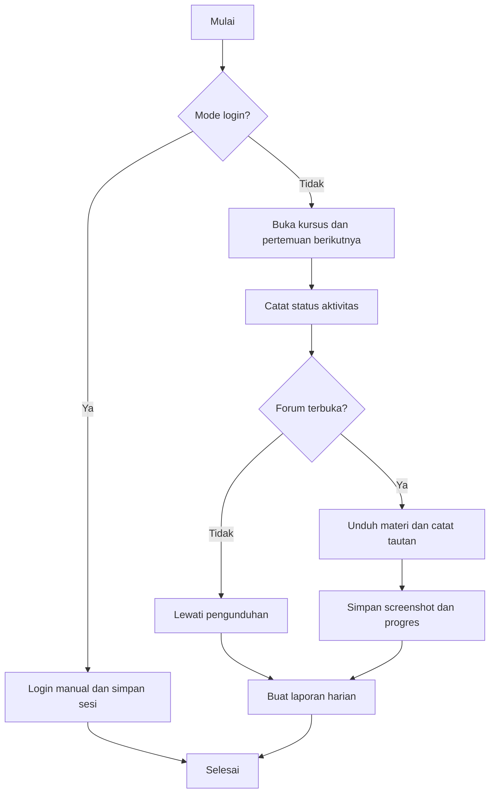

# Mentari UNPAM Automation

Bot otomatis untuk membantu mengecek forum diskusi di Mentari UNPAM, mengunduh materi pertemuan, menyimpan tautan penting, mengambil screenshot, dan menulis laporan harian.

Script ini dibuat untuk mempermudah pekerjaan rutin harian pada mata kuliah tertentu di platform Mentari. Script hanya membantu mengidentifikasi aktivitas dan mengunduh materi yang tersedia; tugas dan aktivitas belajar tetap dilakukan secara manual.

## Fitur

- Membuka halaman kursus dan pertemuan aktif
- Mendeteksi apakah forum diskusi terbuka atau terkunci
- Mengecek keberadaan item seperti Pretest, Posttest, Kuesioner, Penugasan, dan Forum Diskusi
- Mengunduh materi yang tersedia seperti Buku ISBN, Power Point, Artikel Riset, dan Materi Lainnya
- Mencatat tautan Video Ajar dan LINK VCON
- Menyimpan screenshot per pertemuan
- Menulis laporan harian ke file `laporan_YYYY-MM-DD.md`
- Menyimpan progres per mata kuliah di file `_progress.json`

## Alur Kerja



### Langkah Proses

| Langkah | Proses | Hasil |
|---|---|---|
| 1 | Buka Chrome dengan profil tersimpan; atau login manual jika menggunakan mode `--login`. | Sesi Mentari siap digunakan. |
| 2 | Buka setiap kursus dan pertemuan berikutnya berdasarkan progres tersimpan. | Halaman pertemuan dibuka. |
| 3 | Periksa status Pretest, Posttest, Kuesioner, Penugasan, dan Forum Diskusi. | Status dan tautan aktivitas dicatat; aktivitas tidak dikerjakan otomatis. |
| 4 | Periksa apakah Forum Diskusi terkunci. | Jika terkunci, materi dilewati; jika terbuka, proses dilanjutkan. |
| 5 | Jika forum terbuka, unduh materi yang dikonfigurasi dan catat tautan yang ditemukan. | Materi, `links.txt`, dan screenshot tersimpan. |
| 6 | Simpan progres dan laporan harian. | Proses dapat dilanjutkan pada pertemuan berikutnya. |

## Persyaratan

- Node.js 20+
- Browser Chrome yang sudah terpasang
- Akun Mentari UNPAM yang aktif

## Instalasi

1. Clone atau unduh repositori ini.
2. Masuk ke folder project.
3. Jalankan perintah berikut:

```bash
npm install
```

## Login Awal

Sebelum menjalankan script normal, lakukan login manual sekali agar profil Chrome siap dipakai:

```bash
npm run login
```

Setelah jendela Chrome terbuka, login ke Mentari secara manual, lalu tekan Enter di terminal.

## Penggunaan

### Jalankan normal

```bash
npm run run
```

Script akan:

- membuka sesi Chrome yang tersimpan
- membuka kursus dan pertemuan berikutnya
- mengecek status forum diskusi
- mengunduh materi jika forum terbuka
- menyimpan laporan harian dan progres

### Jalankan mode debug

```bash
npm run debug
```

Mode ini menyalin HTML halaman ke folder `debug/` untuk membantu kalibrasi selector jika struktur halaman berubah.

## Konfigurasi

File `config.json` berisi pengaturan utama seperti:

- `baseDir`: folder tempat report dan progress disimpan
- `dashboardUrl`: URL Mentari yang dipakai
- `profileDir`: lokasi profil Chrome untuk session otomatis
- `firstMeeting`: pertemuan pertama yang ingin diproses
- `materialItems`: item materi yang akan diunduh
- `linkItems`: item tautan yang akan dicatat
- `courses`: daftar kursus beserta judul dan nama folder laporan

Edit file tersebut sesuai lingkungan Anda.

## Catatan Penting

- Script tidak mengerjakan Pretest, Posttest, Kuesioner, Penugasan, atau Forum Diskusi secara otomatis.
- Script bergantung pada teks yang tampil di layar. Jika ada perubahan tampilan di Mentari, selector bisa gagal.
- Gunakan mode `debug` untuk memeriksa HTML dan menyesuaikan logic pada `mentari.mjs` bila diperlukan.
- Pastikan `dashboardUrl` di `config.json` sesuai dengan portal Mentari yang Anda gunakan.

## Jadwal Harian (Opsional)

Pada Windows, Anda dapat membuat Task Scheduler agar script berjalan otomatis setiap hari pada jam tertentu:

```bat
schtasks /Create /SC DAILY /ST 08:00 /TN MentariHarian /TR "cmd /c cd /d "D:\unpam\semester 7\_scripts" && node mentari.mjs"
```

Jangan menjalankan task ini bersamaan dengan proses manual atau task lain untuk menghindari duplikasi progres.

## Struktur Project

```text
.
├── README.md
├── config.json
├── mentari.mjs
├── package.json
├── package-lock.json
├── .gitignore
└── debug/   (opsional, dibuat saat mode debug)
```

## Penjelasan Teknis `mentari.mjs`

| Fungsi | Penjelasan teknis |
|---|---|
| `sleep(ms)` | Menunggu selama `ms` milidetik. Dipakai setelah membuka pertemuan agar halaman sempat diperbarui. |
| `safe(s)` | Mengganti karakter yang tidak aman untuk nama file/folder dengan `_`. |
| `esc(s)` | Meng-escape karakter khusus regex supaya teks judul dapat dipakai dengan aman dalam pencarian locator. |
| `loadProgress()` | Membaca `_progress.json`. Jika file belum ada, membuat progres awal tiap kursus berdasarkan `firstMeeting`. |
| `saveProgress(p)` | Menyimpan progres kursus ke `_progress.json` dalam format JSON yang mudah dibaca. |
| `isLoggedOut(page)` | Mendeteksi indikasi logout dari URL atau keberadaan kolom password. |
| `openCourse(page, course)` | Membuka dashboard, memeriksa sesi login, lalu memilih kursus. Jika klik judul tidak berpindah halaman, mencoba tombol pada kartu kursus. |
| `openMeeting(page, n)` | Mencari, menggulir ke, dan membuka bagian “Pertemuan n”. |
| `inspectActivity(page, name)` | Memeriksa keberadaan aktivitas, tautan, dan indikasi nonaktif tanpa membuka atau mengirim aktivitas tersebut. |
| `forumLocked(page)` | Memperkirakan apakah Forum Diskusi terkunci berdasarkan atribut disabled atau petunjuk pada HTML. Ini heuristik, sehingga hasilnya bisa perlu dikalibrasi. |
| `grab(page, context, name, dir, links)` | Mengklik item materi dan mendeteksi hasilnya: unduhan, tab baru, atau navigasi di halaman yang sama. Menyimpan file atau mencatat URL jika terdeteksi. |
| `main()` | Menjalankan browser, menangani mode login, memproses kursus dan pertemuan, membuat laporan, menyimpan progres, serta menutup browser. |
| `main().catch(...)` | Menangani error yang tidak tertangani oleh `main()`, mencetak pesan ke terminal, lalu keluar dengan kode error. |

## Lisensi

Repositori ini dibuat untuk kebutuhan penggunaan pribadi dan internal. Silakan sesuaikan penggunaan sesuai kebutuhan Anda.
