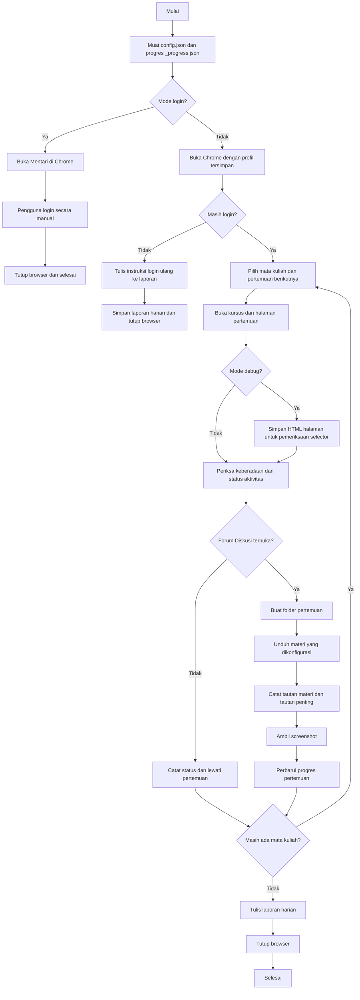

# Alur Kerja Sistem

Dokumen ini menjelaskan alur kerja `mentari.mjs` saat dijalankan. Script membantu memeriksa dan mengarsipkan informasi; aktivitas akademik seperti Pretest, Posttest, Kuesioner, Penugasan, dan Forum Diskusi tetap dilakukan secara manual.

## Diagram alur

## Urutan proses

1. Script membaca `config.json` dan `_progress.json`. Jika berkas progres belum ada, pertemuan berikutnya dimulai dari `firstMeeting`.
2. Untuk login awal, jalankan `npm run login`, lalu masuk ke Mentari secara manual di jendela Chrome. Sesi disimpan di profil Chrome yang dikonfigurasi.
3. Saat berjalan normal, script membuka dashboard Mentari. Jika sesi sudah logout, script mencatat instruksi untuk menjalankan kembali mode login dan menghentikan pemrosesan kursus.
4. Untuk setiap mata kuliah, script memilih pertemuan setelah progres terakhir, membuka halaman kursus dan pertemuan, lalu mencatat keberadaan Pretest, Posttest, Kuesioner, Penugasan, dan Forum Diskusi.
5. Jika mode debug aktif (`npm run debug`), HTML halaman disimpan ke folder `debug/` untuk membantu pemeriksaan selector.
6. Jika Forum Diskusi terdeteksi terkunci atau tidak tersedia, pertemuan dicatat sebagai dilewati. Progres pertemuan tersebut tidak dimajukan, sehingga akan diperiksa kembali pada proses berikutnya.
7. Jika Forum Diskusi terdeteksi terbuka, script mengunduh item dari `materialItems`, mencatat tautan dari `linkItems`, mengambil screenshot, lalu memperbarui progres.
8. Script menyimpan ringkasan hasil ke `laporan_YYYY-MM-DD.md` dan menutup browser.

## Batasan dan pemeriksaan

- Script hanya memeriksa status aktivitas dan mengumpulkan materi/tautan yang dikonfigurasi. Script tidak menjawab, mengirim, atau mengerjakan aktivitas akademik.
- Deteksi status Forum Diskusi menggunakan heuristik terhadap elemen halaman. Periksa laporan dan gunakan mode debug jika hasilnya tidak sesuai.
- Jika terjadi error pada suatu mata kuliah, error dicatat dan pemrosesan dilanjutkan ke mata kuliah berikutnya; progres hanya diperbarui setelah alur pertemuan terbuka berhasil mencapai penyimpanan progres.
- Jangan menjalankan proses otomatis bersamaan agar berkas progres dan hasil tidak bertabrakan.
